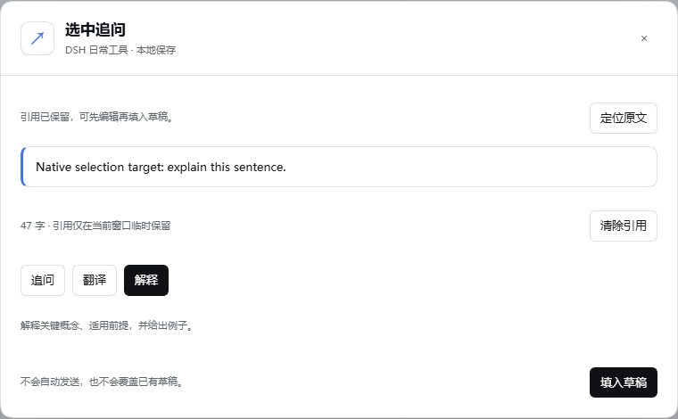
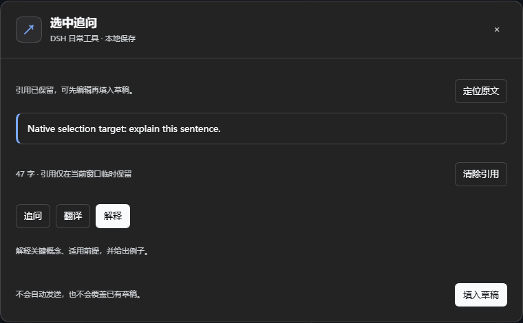

# DSH 日常工具箱

**把常用动作放近一点，把注意力留给正在做的事。**

8 个 DeepSeek Harness 原生插件：少打几次重复指令，找回写到一半的草稿，收藏好回答，记住项目下一步。可以整套安装，也可以只选你需要的功能。

[English](README.en.md) · [安装与升级](docs/INSTALLATION.md) · [开发计划](docs/PLAN.md) · MIT

## 选你用得上的

| 插件与独立仓库 | 什么时候有用 | 使用入口 |
| --- | --- | --- |
| [常用指令快捷面板](https://github.com/yxue301603/dsh-quick-prompts) | 一键填入「继续完成」「检查本次改动」；自定义、置顶、分类、模板变量与最近使用 | 输入框旁「快捷指令」，或置顶指令按钮 |
| [对话目录](https://github.com/yxue301603/dsh-conversation-outline) | 在长对话中搜索自己问过的问题，跳回上下文，继续上次阅读 | 输入框旁「对话目录」 |
| [草稿历史](https://github.com/yxue301603/dsh-draft-history) | 写坏了或误清空后，预览并恢复这个会话的旧草稿 | 输入框旁「草稿历史」 |
| [回答收藏](https://github.com/yxue301603/dsh-answer-library) | 留住有用的命令、解释和摘录，加标签后随时搜索、复制或放回草稿 | 回答下方 `☆`，或输入框旁「回答收藏」 |
| [本轮文件](https://github.com/yxue301603/dsh-turn-files) | 按轮次找交付文件与已记录的改动，复制路径、预览或定位所在目录 | 输入框旁「本轮文件」 |
| [任务提醒](https://github.com/yxue301603/dsh-task-alerts) | 集中查看完成、待确认与失败记录；需要时开启后台系统通知 | 输入框旁「任务提醒」及未读数量 |
| [项目便笺](https://github.com/yxue301603/dsh-project-notes) | 记需求、报错和临时想法；勾选小待办，选中文字交给 AI 继续讨论 | 输入框旁「项目便笺」 |
| [选文操作](https://github.com/yxue301603/dsh-selection-actions) | 选中回答中的一句话，带着引用追问、翻译或解释 | 消息选区旁「选中追问」，或输入框工具区 |

新增工具使用紧凑图标入口，悬停可查看名称，窄窗口下自动换行。每个插件都有中文、英文以及深色、浅色主题样式。

下面是隔离的真实 DSH 中的选文操作面板，使用合成测试内容。

| 浅色主题 | 深色主题 |
| --- | --- |
|  |  |

## 两种安装方式，任选一种

### 整套安装

在 DSH 的「插件 → 添加插件」中粘贴：

```text
https://github.com/yxue301603/dsh-everyday-plugins
```

安装并启用后，按 DSH 提示重新加载。整套包含上面的全部 8 个插件。

### 按需安装

只想要草稿保护或项目便笺？点击表格中的独立仓库，把对应 GitHub 地址粘贴到同一个「添加插件」输入框。各插件可单独安装，不需要总仓库作为依赖。

**不要同时安装整套和其中相同的独立插件**，以免重复入口或重复监听。如果已安装之前的 `dsh-quick-prompts`，转为整套前先卸载独立版；保持同一个 DSH 来源、不清除站点数据时，原有快捷指令使用同一存储键，可以继续读取。

兼容基线是 **DeepSeek Harness 0.2.1-rc.2 及其后的 0.2.x**，面向 Web 与桌面版。尚未验证的版本不作兼容承诺。仓库提供预构建文件，安装者无需 Node.js、编译器或自行构建。

GitHub 安装需要能够访问 GitHub；DSH 中的 npm 镜像选择不会代理 GitHub 下载。详细步骤、独立地址清单和升级说明见 [安装指南](docs/INSTALLATION.md)。

## 你掌握最后一步

插件通过 DSH 原生接口工作，不自动发送消息，不自行调用模型，不需要 API Key。插入到输入框的内容由你检查和发送；「翻译」「解释」也只是先填入请求模板。输入插入保留已有文本，原生修订校验拒绝过期编辑；整段草稿替换另需确认。

收藏、草稿历史、便笺、快捷指令和提醒记录保存在当前 DSH 来源的本地浏览器存储；选文引用只暂存在窗口内存。没有外部同步或推送服务器。文件列表、历史加载和定位使用正在连接的 DSH 宿主；它们可能请求宿主的原生接口，并非所有操作都离线完成。

系统通知默认关闭，只在你主动开启并授予权限后启用；默认静音，DSH 在前台时减少通知。通知只显示会话标题，不显示回答正文。

## 提前说清楚的边界

- **目录只搜索已加载的提问。** 需要时手动加载更早消息，不会为搜索自动拉取整段对话。
- **草稿历史保存纯文本。** 不备份附件文件，也不重建引用芯片；有容量与时间上限，强制崩溃前最后一小段编辑可能未保存。不会进会话就自动覆盖草稿。
- **收藏与便笺是本地资料。** 更换机器或 DSH 来源不会自动同步，清除站点数据会删除记录。损坏数据和写入失败会提示；便笺保存失败时先复制或导出，再退出应用。
- **文件列表有来源范围。** 统计原生交付、改动清单及支持的成功文件写入；仅靠终端创建、没有交付或改动记录的文件可能不在其中。预览取决于宿主能力，打开目录还需要宿主桌面可用。
- **提醒需要客户端保持运行和连接。** 只监听启用后的实时变化，不补发旧历史。缺少明确结束原因时显示「已结束，请查看结果」，不推断成功；待确认依赖宿主提供的当前交互状态。关闭 DSH 后无法继续通知。
- **选文来自已显示的单条消息。** 不支持跨多条消息的混合选区；原消息被卸载后可能无法定位，已经捕获的引用仍可手动使用。

详细限制与存储上限见各独立插件 README。验证进度会记录在 [验证说明](docs/VERIFICATION.md)，未完成的项目见 [开发计划](docs/PLAN.md)。

## 仓库结构

`packages/` 按插件组织源码，每个目录会同步到同名独立 GitHub 仓库。总包整合 8 个插件的预构建客户端；独立包带有自己的构建产物和共享代码，不依赖总仓库目录。

开发者可使用 `npm ci` 安装开发依赖，`npm run build` 构建，`npm test` 运行模型与契约测试；浏览器和真实 DSH 验证以验证说明为准。普通使用者直接在 DSH 安装即可。
