# 八个插件的实际界面 / Gallery

[返回工具箱](../README.md) · [English](../README.en.md) · [安装](INSTALLATION.md)

以下是实际插件组件在隔离测试宿主中的截图，内容为合成数据。原生 DSH 兼容验证另见[验证说明](VERIFICATION.md)；[素材说明与复现](media/README.md)。

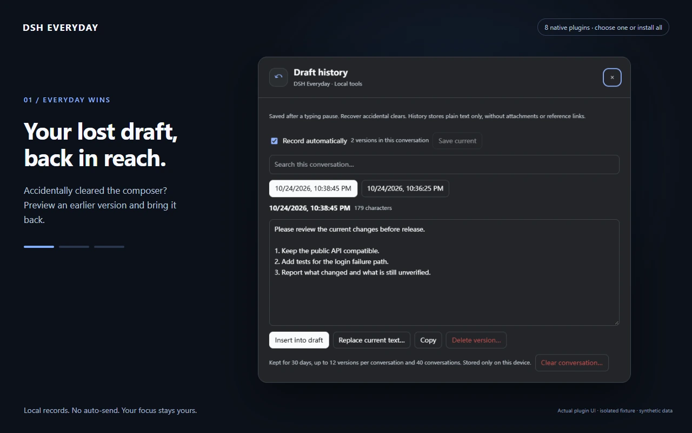

宽输入卡显示工具名称，窄卡自动保留图标：

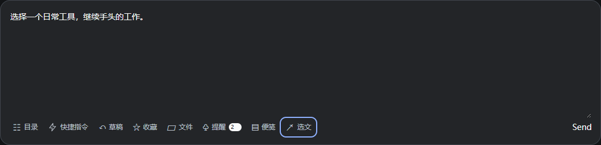

## 常用指令快捷面板 / Quick prompts

反复输入同一句话？把它存成指令，搜索、置顶或按项目使用。 Typing the same instruction again? Save it, pin it, or scope it to a project.

[源码与使用](../packages/dsh-quick-prompts)

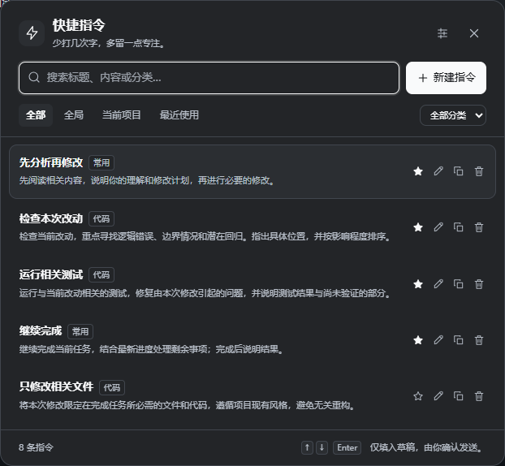

## 对话目录 / Conversation outline

长对话里找不到之前的问题？搜索自己的提问，点一下回到上下文。 Lost an earlier question in a long chat? Search your questions and jump back to context.

[源码与使用](../packages/dsh-conversation-outline)

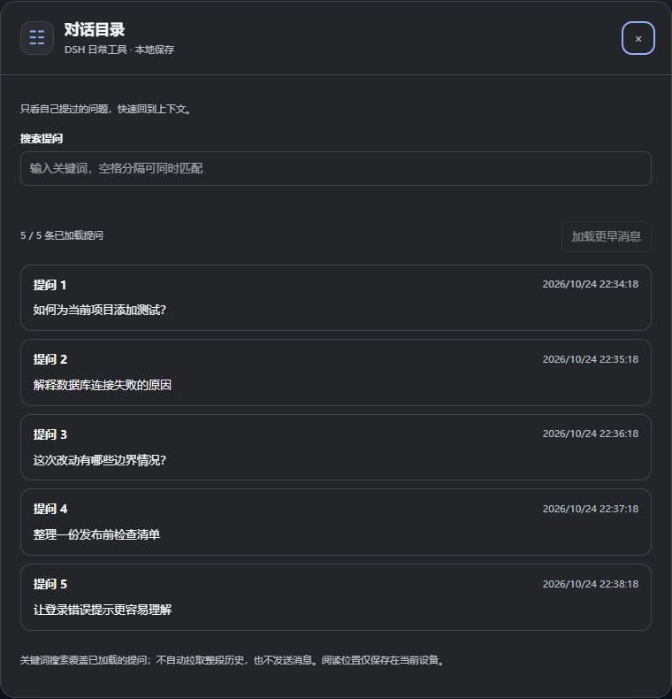

浅色主题 / Light theme

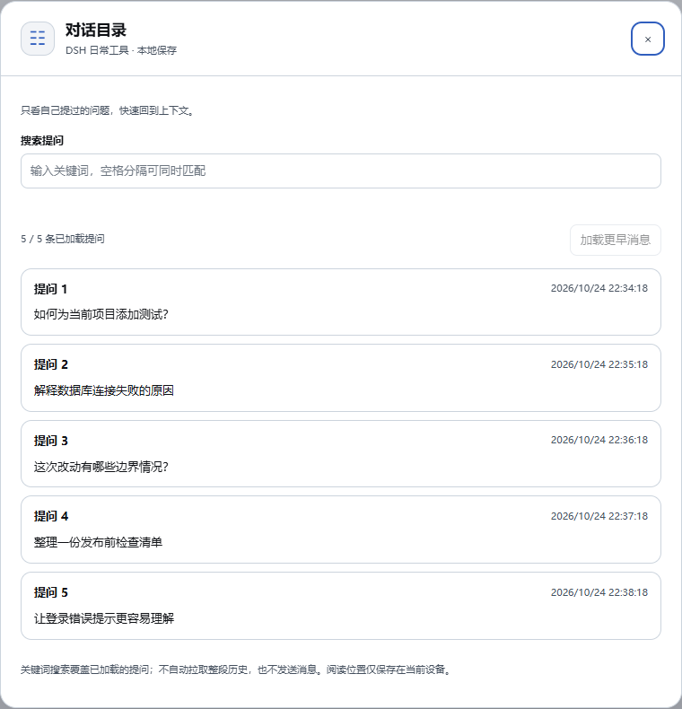

## 草稿历史 / Draft history

刚写好的需求误清空了？先预览这个会话的旧版本，再安全恢复。 Accidentally cleared a draft? Preview an earlier version for this conversation before restoring it.

[源码与使用](../packages/dsh-draft-history)

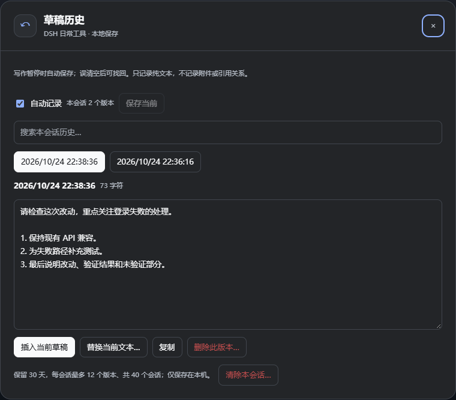

浅色主题 / Light theme

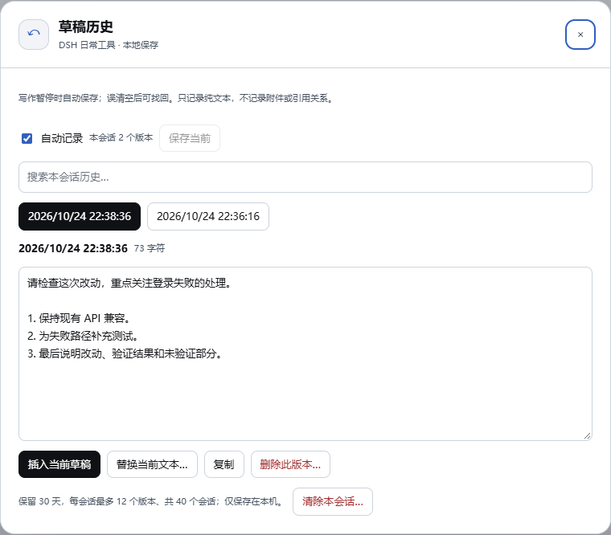

## 回答收藏 / Answer library

把值得复用的命令、解释和摘录留下来；加标签，随时搜索和备份。 Keep useful commands, explanations and excerpts. Add tags, search, reuse, and back up the whole library.

[源码与使用](../packages/dsh-answer-library)

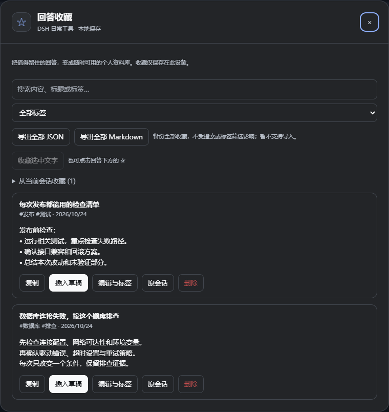

浅色主题 / Light theme

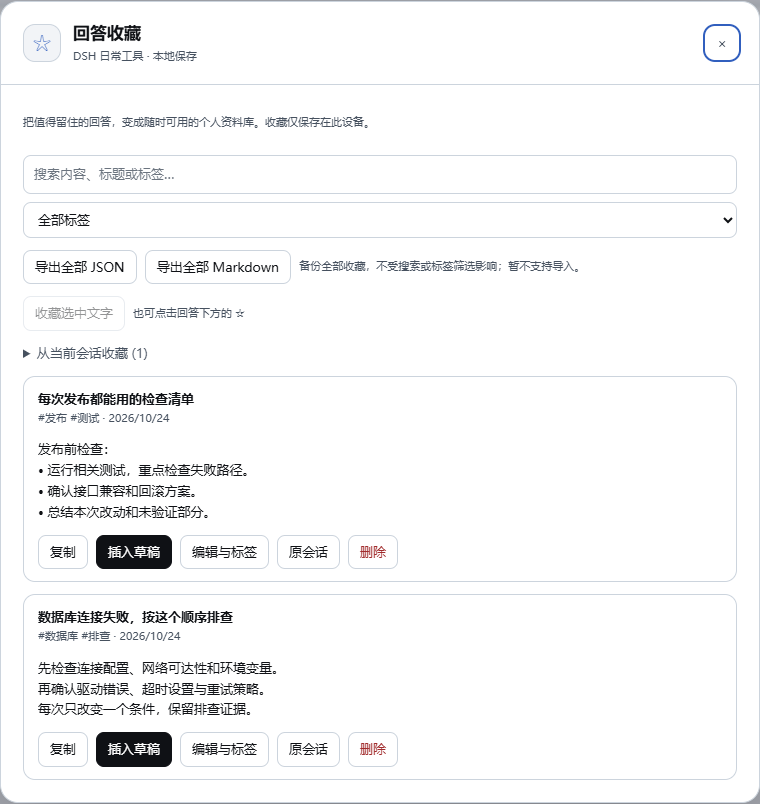

## 本轮文件 / Turn files

AI 做完后去哪找文件？按轮次看交付和已记录的改动，直接预览。 Where are the files after a task? Find delivered and recorded changed files by turn and preview them.

[源码与使用](../packages/dsh-turn-files)

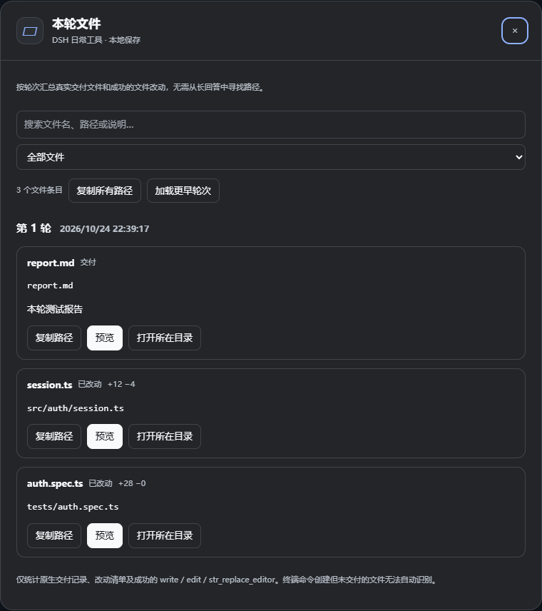

## 任务提醒 / Task alerts

切去忙别的，再回来集中看哪些会话完成、失败或在等你确认。 Return to a clear list of conversations that finished, failed or need your attention.

[源码与使用](../packages/dsh-task-alerts)

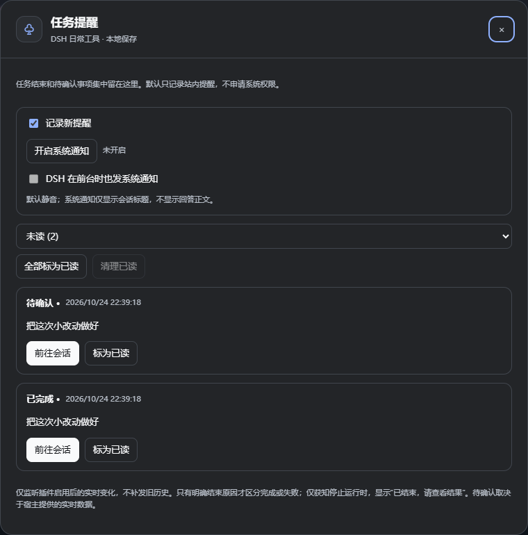

## 项目便笺 / Project notes

需求、报错、下一步：留在当前项目的便笺和小待办里。 Keep requirements, errors and next steps in notes and a small checklist for each workspace.

[源码与使用](../packages/dsh-project-notes)

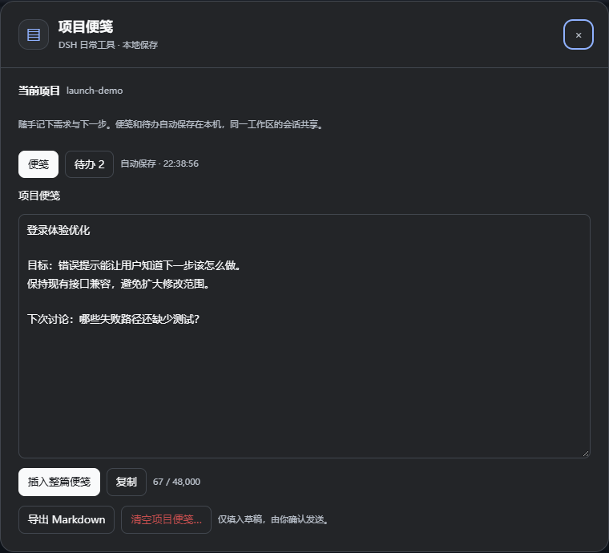

## 选文操作 / Selection actions

选中回答里的一句话，带着引用继续追问、翻译或解释。 Select a passage and prepare a quoted follow-up, translation or explanation.

[源码与使用](../packages/dsh-selection-actions)

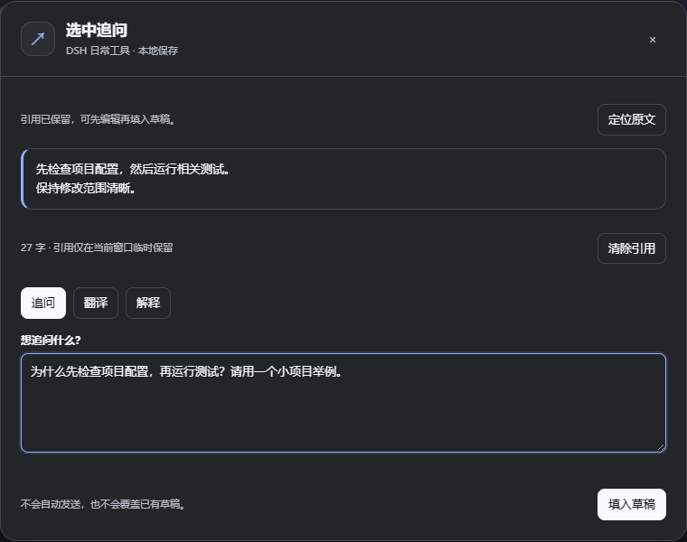

## 选文与收藏互不遮挡

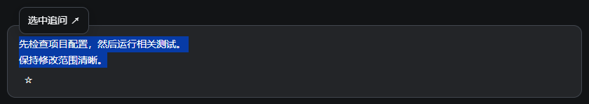

所有展示内容均为合成数据；翻译、解释或追问只填入草稿，由使用者自行发送。
